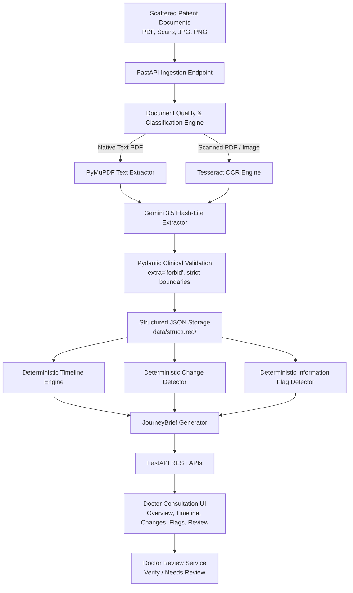

# JourneyBrief — Cancer Care Consultation Readiness & Patient Journey Review

[](https://www.python.org/)
[](https://fastapi.tiangolo.com/)
[](https://ai.google.dev/)
[](#15-running-tests)
[](#8-synthetic-data-disclaimer)

---

## 1. Project Overview

**JourneyBrief** is a clinician-facing assistive tool engineered for consultation preparation in the **Cancer Care** domain. It converts scattered, multi-source patient records (clinic notes, pathology reports, laboratory results, imaging summaries, and prescriptions) into a consolidated, chronological, source-linked patient journey brief.

Every displayed clinical fact is strictly anchored to its original source document and page number. JourneyBrief is strictly an assistive documentation tool; it does not diagnose, stage cancer, assess prognosis, or recommend clinical treatments. Clinician review is mandatory.

---

## 2. Problem Statement

Cancer care patients typically present with voluminous, fragmented medical histories spanning multiple institutions:
- Clinical consultations, pathology analyses, blood work, PET/CT imaging, and prescriptions arrive as separate PDFs, photocopied documents, and photos.
- Oncologists have limited consultation time to manually cross-reference prior test results, detect changes over time, or track pending investigations.
- Generic LLM summaries hallucinate clinical conclusions, omit page citations, or invent clinical interpretations that risk patient safety.

---

## 3. The Solution

JourneyBrief provides an automated, safe, and deterministic ingestion-to-synthesis pipeline:
1. **Multi-Format Ingestion**: Accepts clean PDFs, scanned documents, and image formats (PDF, PNG, JPG, JPEG).
2. **Quality & OCR Routing**: Assesses DPI, text density, rotation, and triggers Tesseract OCR only when needed.
3. **Controlled Structured Extraction**: Uses Google Gemini 3.5 Flash-Lite exclusively for extracting factual entities into strict Pydantic schemas.
4. **Deterministic Synthesis**: Builds the patient journey timeline, detects parameter changes, and flags information gaps using 100% deterministic algorithms (zero LLM summarization).
5. **Universal Source Provenance**: Every displayed fact includes document filename and page number with a one-click source viewer.
6. **Doctor Review & Verification**: Provides a checklist where clinicians review each item (`[Verify]` or `[Needs Review]`) before consultation.

---

## 4. Architecture



---

## 5. End-to-End Pipeline Workflow

1. **Upload**: Clinician uploads single or multiple medical documents via UI or API.
2. **Classify**: Ingestion classifies files into `TEXT_PDF`, `SCANNED_PDF`, or `IMAGE`.
3. **Quality Check**: Validates resolution, text density, blank pages, and rotation.
4. **OCR (Conditional)**: Scans and images route through Tesseract 5.5.3; clean text PDFs bypass OCR.
5. **Extraction**: Gemini 3.5 Flash-Lite extracts explicitly documented facts without clinical interpretation.
6. **Validation**: Pydantic models enforce strict typing, bounding confidence values (0.0 to 1.0) and prohibiting clinical judgment fields.
7. **Timeline Generation**: Events are chronologically ordered with exact date and source references.
8. **Change Detection**: Detects parameter changes (e.g. Hemoglobin 13.4 → 12.8 g/dL) with strictly neutral wording.
9. **Documentation Flags**: Identifies missing records or pending lab results without clinical risk scoring.
10. **JourneyBrief Synthesis**: Assembles the complete brief deterministically.
11. **Doctor Review**: Clinician reviews extracted items against source pages.

---

## 6. Technology Stack

- **Backend Framework**: Python 3.11, FastAPI, Uvicorn
- **Data Validation & Schemas**: Pydantic v2 (`strict=True`, `extra='forbid'`)
- **PDF & Document Processing**: PyMuPDF (fitz) v1.25.3
- **Optical Character Recognition (OCR)**: Tesseract OCR 5.5.3 via pytesseract
- **LLM Provider**: Google Gemini 3.5 Flash-Lite via `google-genai`
- **Offline LLM Fallback**: Ollama / Llama 3.1:8b
- **Synthetic Document Generation**: ReportLab
- **Frontend**: Vanilla HTML5, CSS3 (Enterprise Medical Design System), Vanilla JavaScript (ES6)
- **Automated Testing**: Python `unittest`, FastAPI `TestClient` (153 tests)

---

## 7. Strict Safety Boundaries

> [!CAUTION]
> **CRITICAL CLINICAL SAFETY RULES**
>
> JourneyBrief is strictly an assistive documentation tool. The system will **NEVER**:
> 1. Make a medical diagnosis.
> 2. Infer cancer stage (e.g. Stage II vs Stage III).
> 3. Predict patient prognosis or survival.
> 4. Infer disease progression or tumor enlargement.
> 5. Assess treatment response (e.g. "improved", "worsened", "partial response").
> 6. Assign severity scores or clinical risk categories.
> 7. Recommend medications, dosages, radiation, or surgical procedures.
> 8. Provide autonomous medical advice or clinical decision support.
>
> **Rules for Displayed Data**:
> - **Lab Results**: Documented numeric values, units, and reference ranges only.
> - **Imaging Reports**: Verbatim factual report observations only.
> - **Documentation Flags**: Information-completeness issues only; never clinical alarms.
> - **Source Provenance**: Every displayed item exposes `document_id`, `file_name`, and `page_number`.
> - **Mandatory Review**: Clinician is the final and sole decision-maker.

---

## 8. Synthetic Data Disclaimer

All data in this repository and prototype is **100% synthetic demonstration data**:
- **Patient Identifier**: `SYN-CANCER-001`
- **Documents**: 10 synthetic clinical documents generated via ReportLab (`doc-001` through `doc-010`).
- **Benchmarking**: Evaluation metrics represent recall against synthetic ground-truth test cases and **do NOT represent real-world clinical performance**.
- **Privacy Notice**: Real patient health records must never be uploaded without institutional IRB, HIPAA, and data governance approvals.

---

## 9. Setup Instructions

### Prerequisites
- Python 3.11 installed
- Tesseract OCR 5.5.3 installed (Default: `C:\Program Files\Tesseract-OCR\tesseract.exe`)
- Google Gemini API Key

### Installation

```powershell
# 1. Clone repository and navigate to root
cd d:\JourneyBrief

# 2. Activate virtual environment
.venv\Scripts\Activate.ps1

# 3. Install dependencies
pip install -r requirements.txt
```

---

## 10. Environment Variables

Create or update `.env` in the project root:

```env
# Google Gemini Configuration
GEMINI_API_KEY=your_gemini_api_key_here
GEMINI_MODEL=gemini-3.5-flash-lite

# Offline Fallback (Optional)
OLLAMA_BASE_URL=http://127.0.0.1:11434
OLLAMA_MODEL=llama3.1:8b
OLLAMA_TIMEOUT=120

# Tesseract OCR Configuration
TESSERACT_PATH="C:\Program Files\Tesseract-OCR\tesseract.exe"

# Application Settings
APP_NAME=JourneyBrief
DEBUG=false
```

---

## 11. Gemini Configuration

JourneyBrief uses `google-genai` with model `gemini-3.5-flash-lite`:
- Temperature is set to `0.0` for maximum extraction determinism.
- Strict system instructions forbid extrapolation, diagnosis, or clinical scoring.
- Gemini is used **only** for structured entity extraction from document pages.
- Downstream synthesis (Timeline, Changes, Flags, Brief) is **100% deterministic code** and does not invoke Gemini.

---

## 12. Tesseract OCR Setup

JourneyBrief integrates with local Tesseract OCR 5.5.3:
- Path configured via `TESSERACT_PATH` in `.env`.
- Documents classified as `SCANNED_PDF` or `IMAGE` are rendered at 300 DPI, pre-processed (contrast, binarization), and transcribed.
- Technical optical confidence scores are captured per page without conflating optical confidence with clinical correctness.

---

## 13. Tamil OCR Status & Limitation

- **Installed Language Packs**: `eng` (English), `osd` (Orientation and Script).
- **Tamil Language Pack**: `tam.traineddata` is **not installed** in local tessdata.
- **Truthfulness Commitment**: JourneyBrief explicitly and truthfully reports Tamil OCR as **unavailable** in the UI and documentation until `tam.traineddata` is installed in `C:\Program Files\Tesseract-OCR\tessdata`.

---

## 14. Running the Application

Start the FastAPI application with Uvicorn:

```powershell
.venv\Scripts\python -m uvicorn app.main:app --host 127.0.0.1 --port 8000
```

Open the Doctor Consultation UI in your browser:
```
http://127.0.0.1:8000/
```
*(Or `http://127.0.0.1:8000/ui`)*

---

## 15. Running Tests

The test suite contains **153 automated tests** covering all pipeline layers:

```powershell
# Run full automated test suite
.venv\Scripts\python -m unittest discover -s tests -v
```

### Test Suite Structure
- `tests/test_models.py`: Pydantic models, boundaries, and schema enforcement (10 tests)
- `tests/test_document_ingestion.py`: Ingestion, MIME types, and classification (8 tests)
- `tests/test_document_quality.py`: Technical quality, DPI, blank page, and rotation checks (7 tests)
- `tests/test_ocr.py`: Optical character recognition, confidence, and source metadata (7 tests)
- `tests/test_multilingual_ocr.py`: Tesseract languages detection and truthful Tamil capability checks (4 tests)
- `tests/test_extractor.py`: Structured fact extraction and Pydantic validation (12 tests)
- `tests/test_timeline.py`: Chronological timeline engine and ordering (5 tests)
- `tests/test_change_detector.py`: Deterministic documented change tracking (7 tests)
- `tests/test_flag_detector.py`: Information gap detection and missing records (7 tests)
- `tests/test_journey_brief.py`: Deterministic brief synthesis and markdown export (5 tests)
- `tests/test_review.py`: Doctor review service, verification, and audit trail (5 tests)
- `tests/test_api.py`: FastAPI endpoints, 404 handling, and file uploads (11 tests)
- `tests/test_final_integration.py`: End-to-end integration, batch uploads, measured processing time, demo reset, and complete demo sequence (18 tests)
- `tests/test_documents.py`, `tests/test_ground_truth.py`, `tests/test_evaluation.py`: Synthetic ground truth and documents validation (48 tests)

**Status**: 152 passed, 1 skipped (offline LLM test), 0 failed.

---

## 16. Demo Flow Guide

Follow this sequence for hackathon presentations:

1. **Open UI**: Navigate to `http://127.0.0.1:8000/`.
2. **Review Overview**:
   - Inspect Patient ID: `SYN-CANCER-001`, `Synthetic Demo Data` badge, and dynamic KPI cards (10 Documents, 65 Timeline Events, 6 Documented Changes, 4 Flags).
3. **Upload Documents**:
   - Click `Upload & Ingestion` tab.
   - Drag and drop clean PDFs, scanned documents, and images (`.pdf`, `.png`, `.jpg`).
   - Click `[ Process Documents ]`.
   - Observe the 10-stage processing pipeline and measured duration callout (*"Processing completed in X seconds"*).
   - Review the Processed Documents results table.
4. **Explore Recent Timeline**:
   - View chronological events with category tags and dates.
   - Click `[ Open source page ]` to inspect the original PDF page in the viewer modal.
5. **Inspect What Changed**:
   - Review neutral parameter shifts (e.g., Hemoglobin 13.4 → 12.8 g/dL) across document dates.
6. **Review Documentation Flags**:
   - Inspect information gap checks (e.g. pending MRI report) without clinical alarmist phrasing.
7. **Doctor Review Checklist**:
   - Switch to the `Doctor Review` tab.
   - Mark an item `[ Verify ]` (confirms clinician reviewed against source).
   - Mark another item `[ Needs Review ]` (flags for follow-up).
   - Toggle overall status to `REVIEWED`.
8. **Evaluation & Metrics**:
   - Review technical benchmarks: 100% recall on 10-document synthetic ground truth set, 100% provenance retention, and truthful Tamil OCR limitation disclosure.
9. **Reset Demo Data**:
   - Click `[ Reset Demo Data ]` and confirm to restore the pristine 10-document baseline before the next demonstration.

---

## 17. Evaluation Methodology

- **Ground-Truth Dataset**: `data/ground_truth/patient_001.json` containing verified expected facts across 10 synthetic documents.
- **Metric Definition**:
  - **Ground-Truth Recall**: Fraction of expected ground-truth facts successfully extracted and validated by Pydantic models.
  - **Current Result**: 100% recall on the 10-document synthetic ground-truth evaluation set.
  - **Provenance Retention**: 100% (Every extracted clinical fact preserves document ID and page number).
- **Integrity Rule**: Ground-truth recall measures information retrieval coverage against synthetic benchmarks; it must **never** be cited as clinical diagnostic accuracy.

---

## 18. Hackathon Judge Q&A Reference

A comprehensive technical defense guide addressing 28 common questions on architecture, hallucinations, RAG comparison, failure modes, privacy, and offline capabilities is available at:
👉 **[docs/JUDGE_QA.md](docs/JUDGE_QA.md)**

---

## 19. Current Prototype Capabilities vs. Future Production Roadmap

| Capability | Current Prototype (Stage 18) | Future Production Roadmap |
| :--- | :--- | :--- |
| **Domain** | Cancer Care (`SYN-CANCER-001`) | Broad Oncology & Chronic Care EHR integration |
| **Data Scope** | 100% Synthetic Ground-Truth Documents | Real EHR with HIPAA BAA & IRB clearance |
| **Persistence** | Local Structured JSON (`data/`) | Enterprise PostgreSQL with Row-Level Security |
| **Document Ingestion** | Local File Upload (PDF, PNG, JPG) | Direct HL7 / FHIR Integration (Epic, Cerner) |
| **Provenance** | Document ID + Exact Page Number | Page Number + Bounding Box Highlight Overlays |
| **OCR Languages** | English (`eng`), Script/Orientation (`osd`) | Multilingual packs (Tamil, Hindi, regional Indian languages) |
| **Extraction Model** | Gemini 3.5 Flash-Lite (Ollama fallback) | Fine-tuned On-Premise LLM / Enterprise Private Cloud |
| **Downstream Synthesis** | 100% Deterministic Python Engines | 100% Deterministic Python / Rust Engines |
| **Clinician Review** | Single-user Checklist (`Verify` / `Needs Review`) | Multi-user Role-Based Care Team Sign-Off Workflow |
| **Safety Boundary** | Zero Diagnosis / Staging / Treatment Inference | Preserved: Strictly Assistive Non-Diagnostic Tool |

---

## 20. Known Limitations

1. **Synthetic Data Only**: Validated exclusively on synthetic oncological records; clinical validation on real-world EHR records requires institutional data governance.
2. **Local Tesseract Languages**: English (`eng`) and orientation (`osd`) installed; Tamil OCR is unavailable until `tam.traineddata` is added to tessdata.
3. **Visual Highlighting**: "Open source page" opens the original document page; pixel/bounding-box text highlighting on scanned PDFs is not yet implemented.
4. **Prototype Persistence**: Uses local JSON files in `data/` rather than an enterprise database.
5. **Non-Clinical Flags**: Documentation flags detect missing records deterministically; they do not assess clinical risk.

---

## 21. Future Work

- **Enterprise EHR Integration**: HL7 / FHIR integrations for ingestion directly from hospital record systems.
- **Bounding Box Highlights**: PDF and image bounding-box overlays to highlight exact text regions on source pages.
- **Multilingual Language Packs**: Installation and calibration of Tamil, Hindi, and regional language OCR packs.
- **Production Database**: Migration from JSON prototypes to PostgreSQL with row-level security and HIPAA audit logging.
- **Care Team Collaboration**: Multi-user role-based access control (RBAC) allowing oncology fellows, attending physicians, and care navigators to collaborate on the brief.
